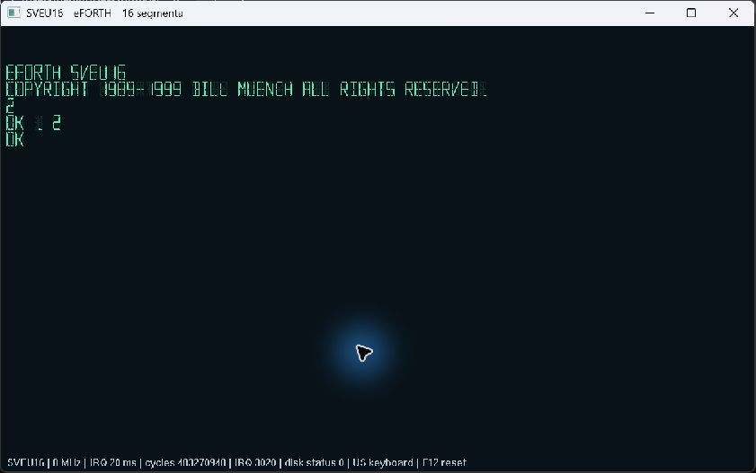
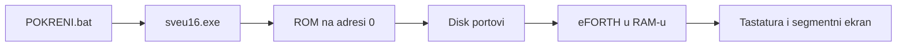

# SVEU16 — projekat iz Naprednih operativnih sistema

Sistemska virtualna mašina u **C-u za Windows**: procesor SVEU16, direktno poravnato interpretiranje, ROM boot loader, eFORTH sa emuliranog diska, 16-segmentni ekran 80 × 25, tastatura sa sken kodovima i tajmerski prekidi.

## Prvo pogledaj

- **[Nacrtani vodič za pokretanje i ručnu provjeru](predaja/POCNI_OVDJE.pdf)** — 6 stranica, dijagrami, komande i očekivani rezultati.
- **[Kompletan paket za Windows](https://github.com/nomanovic3/napredni-operativni-sistemi-projekat/raw/refs/heads/main/downloads/SVEU16_predaja.zip)** — izvršni program, firmware, disk, izvori i dokumentacija; nije potreban kompajler.
- **[Tehnički izvještaj](predaja/docs/IZVJESTAJ.pdf)** — šta je implementirano, kako i zašto.
- **[Objašnjenje koje se čita direktno na GitHubu](predaja/docs/OBJASNJENJE.md)** i **[priprema za odbranu](predaja/docs/ODBRANA.md)**.



## Pokretanje

1. Preuzmi i raspakuj cijeli Windows paket, ili kloniraj repozitorij i otvori `predaja/`.
2. Pokreni `POKRENI.bat` ili `sveu16.exe`.
3. Klikni u prozor, pritisni Enter, zatim unesi `DECIMAL` i potvrdi Enterom.
4. Probaj sljedeće linije:

```forth
2 3 + .
: KVADRAT DUP * ;
9 KVADRAT .
```

Očekivani rezultati su **5** i **81**. OS početno koristi HEX; zato se prvo unosi `DECIMAL`. Tastatura koristi US raspored fizičkih tipki. `F12` resetuje računar, ali čuva sadržaj diska.



## Organizacija repozitorija

| Putanja | Sadržaj |
| --- | --- |
| [`predaja/src/`](predaja/src/) | C jezgro procesora, uređaji, Windows interfejs i asembler |
| [`predaja/firmware/`](predaja/firmware/) | Boot loader i prilagođeni eFORTH u SVEU16 asembleru |
| [`predaja/tests/`](predaja/tests/) | CPU testovi, referentni model, integracijski testovi i rezultati |
| [`predaja/docs/`](predaja/docs/) | Izvještaj, objašnjenje, snimak i priprema za odbranu |
| [`predaja/README.md`](predaja/README.md) | Detaljna uputstva za pokretanje, izgradnju i ograničenja |
| [`materijali/`](materijali/) | Postavka sa slike, specifikacija SVEU16 i originalni nastavni ZIP |
| [`downloads/`](downloads/) | Provjereni paket za preuzimanje |

Preuzeti kompajleri, lokalne putanje, privremene slike i Python keš nisu dio repozitorija.

## Testiranje i izgradnja

Zatvori emulator i pokreni `predaja/TESTIRAJ.bat`. Završni rezultat treba biti **PASS**. Ručne provjere ekrana, ROM-a, tastature, prekida i trajnosti diska opisane su u vodiču.

Napredni integracijski testovi koriste Python 3 bez dodatnih paketa i privremenu kopiju diska:

```powershell
cd predaja
python tests/integration.py
```

Ponovna izgradnja zahtijeva GCC/MinGW-w64 ili LLVM-MinGW sa podrškom za GNU C computed goto:

```powershell
.\build.ps1 -CC 'C:\putanja\do\mingw\bin\gcc.exe' -RunCpuTests
```

PowerShell skripte se pokreću samo u okruženju koje ih dopušta. Za gotov program i osnovni test nisu potrebne promjene PowerShell postavki.

CPU i uređajske provjere prošle su **74.901 tvrdnju**, uključujući svih **65.536 kodiranja instrukcija** za izabrana stanja registara. Završni emulator prošao je integracijske provjere Forth-a, diska, trajnosti zapisa, skrolovanja i Backspace-a. Rezultati nisu formalni dokaz odsustva svake moguće greške. U izvještaju je zabilježena i Windows Application Control blokada naknadno izgrađenog zasebnog testnog EXE-a; glavni emulator je nakon toga provjeren.

## Porijeklo

Projekt je prilagodba dostavljenog nastavnog materijala. Originalni eFORTH i autorski navodi su sačuvani; novi C emulator, prilagođeni drajveri, testovi i dokumentacija pripremljeni su uz pomoć AI asistenta. Detalji su u [`IZVORI.md`](predaja/IZVORI.md). Ovaj repozitorij ne dodjeljuje novu licencu preuzetim nastavnim materijalima.
